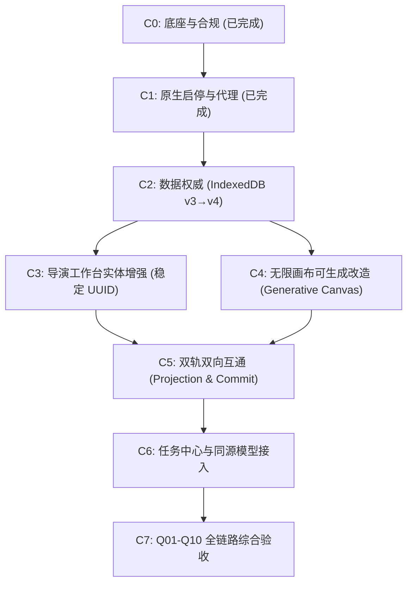

# BigBanana Fork Studio 核心交接与落地指导手册 (Project Handoff Bible)

> **版本**：v1.0.0  
> **更新时间**：2026-10-26  
> **适用对象**：后续接手或协作的 Lead、工程师、子 Agent 及测试验证团队  
> **核心目标**：将 BigBanana AI Director 改造为开箱即用的「导演工作台 + 无限自由画布」纯原生双轨影视生成系统。

---

## 一、战略转向与核心决策矩阵 (Strategic Pivot & Locked Decisions)

### 1.1 核心战略转向背景
在前期探索中（即 `specs/005-dramaclaw-studio`），曾计划将外部 DramaClaw 全栈（包含 Python FastAPI、SQLite、Docker 等）作为底座。经过严格的代码事实审计与工程可行性复盘，该方案因强制绑定 Python 环境与 Docker 容器、存在异构许可证冲突风险、双数据库状态割裂等问题而被**彻底废除**。

**当前唯一产品主线**：确立以经过验证的成熟纯前端/本地优先产品 **BigBanana AI Director** 归档源码为唯一产品底座，构建纯原生、零外部数据库依赖、开箱即用的工作站。

### 1.2 核心决策锁定清单
下表列出所有已锁定的技术决策与架构红线，严禁在后续开发中私自颠覆：

| 维度 | 锁定决策 | 关键技术实现与影响 | 严禁行为 (Redlines) |
|---|---|---|---|
| **产品底座** | **BigBanana 归档源码** | 产品仓自 `archive/.../apps/bigbanana-ai-director` 导入至 `E:\all-agent-workspace\BigBanana`。以独立 Git 仓库管理。 | 严禁以 DramaClaw 作为底座；严禁修改只读归档目录。 |
| **开源许可证** | **CC BY-NC-SA 4.0** | 个人及非商业用途；严格遵守署名、非商业、相同方式共享；保留原始 `NOTICE` 与致谢；保留默认 `api.antsk.cn` 全局模型转发端点。 | 严禁移除原作者版权致谢；严禁私自改为商业化许可或闭源。 |
| **数据权威** | **IndexedDB + OPFS** | 单一数据权威位于浏览器端 `BigBananaDB`（IndexedDB）与私有文件系统（OPFS）；服务层仅做静态托管与同源反向代理，无后端持久化数据库。 | 严禁移植片场的 Go workspace-service、SQLite、CAS 存储或 Works 账本。 |
| **Origin 绑定** | **正式固定 3005** | **正式运行 Origin**：`http://127.0.0.1:3005`<br>**开发调试 Origin**：`http://127.0.0.1:5173`<br>由于浏览器数据隔离，数据物理锁死在 Origin 下。 | 严禁开发与正式混用端口导致用户数据“假性丢失”；严禁随意更换正式服务端口。 |
| **画布引擎** | **扩展 InfiniteCanvas** | 解除现有自绘画布的 `inspect-only` 模式，增量扩展支持持久化拓扑图、配置节点、参考图插槽、生成任务与产物展示。 | 严禁引入 React Flow 或重型第三方外挂画布框架。 |
| **双向互通** | **Clean-Room 净室实现** | 深度提炼 DramaClaw 的 12 条互通行为契约（Projection 1:1 投影与 Commit 安全写回），基于 TypeScript/React 净室自主实现。 | 严禁复制或直接搬运包含 ELv2 商业许可证的上游代码。 |
| **启动运维** | **纯原生 Node/PowerShell** | 单机脚本化启动；Vite 提供开发代理，Node 原生静态服务器提供生产态服务；提供 PID 托管与健康检查。 | 严禁引入 Docker、Docker Compose 或 Nginx 容器化依赖。 |
| **规格文档** | **006 唯一生效，005 冻结** | `specs/006-bigbanana-fork-studio` 为唯一产品 SDD；`specs/005-dramaclaw-studio` 顶部打上冻结横幅作为历史参考。 | 严禁继续推进 005 遗留的 TanStack 切换任务。 |

---

## 二、仓库全景与当前已完成基建 (C0 & C1 验收)

当前产品主仓位于：`E:\all-agent-workspace\BigBanana`。

### 2.1 目录结构与关键职责
```text
E:\all-agent-workspace\BigBanana/
├── components/          # 导演工作台（StageScript/Assets/Director/Export）与 InfiniteCanvas
├── services/            # IndexedDB 存储服务、OPFS 视频管理、模型调用核心
├── server/
│   ├── newApiProxyCore.mjs   # 同源大模型转发核心（支持 api.antsk.cn 及自定义端点）
│   ├── mediaProxyServer.mjs  # 独立媒体反代（解决跨域图片防盗链）
│   └── prodServer.mjs        # [C1] 生产态一体化服务器（静态 dist 托管 + 双代理路由）
├── scripts/
│   ├── start-dev.ps1         # [C1] 一键启动开发态 (strictPort: 5173)
│   ├── start-prod.ps1        # [C1] 一键启动生产态 (strictPort: 3005)
│   ├── stop.ps1              # [C1] 精确停止运行中进程（带进程归属校验，杜绝误杀）
│   ├── status.ps1            # [C1] 检查服务状态与 HTTP 探针健康状况
│   ├── sync-demo-assets.ps1  # [C1] 按需同步恢复归档的 2 个 102MB 示例 JSON
│   └── check-utf8.mjs        # 编码规范检查
├── types.ts             # 核心领域模型（Shot, Keyframe, Interval, MediaCanvasState 等）
├── vite.config.ts       # [C1] Vite 配置（配置 strictPort: 5173，集成开发态反代中间件）
├── BASELINE.md          # [C0] 基线快照与导入溯源记录
├── baseline-manifest.sha256 # [C0] 279 个基线源文件 SHA256 完整性清单
├── NOTICE               # [C0] 开源合规声明与致谢
├── LICENSE              # [C0] CC BY-NC-SA 4.0 许可证正文
└── HANDOFF.md           # [本手册] 项目核心交接与落地指导文档
```

### 2.2 已交付切片明细与验证依据
- **C0 底座初始化与合规固定（已通过）**：
  - 源码脱敏：已剔除归档内无用的 Dockerfile、docker-compose、nginx.conf 及无关构建产物；
  - 完整性保护：`baseline-manifest.sha256` 已落盘，可通过 PowerShell 进行单向防篡改校验；
  - Git 初始化：已完成 `git init` 并完成首个规范化 Commit（提交哈希 `c39e104` 序列），工作区状态干净。
- **C1 原生启停与同源代理（已通过）**：
  - `server/prodServer.mjs` 语法测试通过（`node --check` pass）；
  - 4 个 PowerShell 脚本已通过语法树解析校验；
  - 端口约定强固：开发态强制 5173，生产态强制 3005；生产态自动探测 `dist/` 存在性并提供友好构建引导。

---

## 三、模型调用与多 Agent 协作规则 (Agent Coordination)

为配合用户“全流程调度 Gemini / AGY 模型”的要求，所有参与协作的 Agent 必须遵循以下路由与纪律：

### 3.1 DSH 原生 Team 队员命名规则（关键门禁）
宿主已通过**本地 link 安装**（非社区市场下载）加载 [`dsh-subagent-model-config`](file:///E:/all-agent-workspace/dsh-projects/external/dsh-subagent-model-config) v0.3.2：
- **安装方式**：源目录 `E:/all-agent-workspace/dsh-projects/external/dsh-subagent-model-config`；desktop profile 用 Junction + `link:` 依赖 + `dsh.profile.bundles` 加载，实测**热生效、无需重启**。
- **命名规则**：`spawn_teammate` 名称命中 `agy-*` / `gemin*` / `worker*` / `sub-*` / `reviewer*` / `audit*` 等规则后，自动在 `startActivation` 阶段注入 `provider: "antigravity", model: "gemini-3.8-flash"`。
- **原生 Sub 支持（本机补丁）**：`subagent` 工具无 name 参数，但会把 `description` 作为 `spec.label` 传入；插件已加 label 回退（仅当无编队队员名时生效），因此 description 以 `agy-` 等前缀开头同样可注入 AGY。证据：插件目录 `.probe.jsonl` 中 `startActivation-called` 的 `nameSource: "label"` 记录。
- **未命中的后果**：普通名称回退主会话默认模型。安装/回滚细节见 `ADAPTATION-20261026.md`（同插件目录）。

### 3.2 外部 AGY CLI (`agy.exe`) 并发调用
针对需要深度思考、红蓝审查或无环境冲突的分析任务，可直接调用本地 AGY 命令行工具：
- **二进制路径**：`C:\Users\ldc\AppData\Local\agy\bin\agy.exe` (版本 v1.4.7)
- **典型调用模式**：
  ```powershell
  & "C:\Users\ldc\AppData\Local\agy\bin\agy.exe" -p "审查 006 规格中的存储迁移方案" --model gemini-3.8-flash-high --mode plan
  ```
- **核心优势**：完全独立于 DSH 宿主上下文与事件循环，高并发且绝不阻塞当前交互。

### 3.3 文件写入独占范围约束 (ownedFiles)
为避免多 Agent 并行开发时发生 Git 冲突或相互覆盖：
- 任何派发的任务必须显式声明独占的 `ownedFiles`；
- 成员仅在被授权的目录/文件范围内执行修改；禁止越权修改他人负责的模块。

---

## 四、后续迭代路线图与执行切片 (C2 – C7 Implementation Slices)

后续接手团队应按照以下依赖拓扑顺序推进开发：



### 切片 1：C2 数据权威与存储模型升级 (预计 1-2 天)
- **目标**：在不破坏历史工程的前提下，将 `BigBananaDB` 的 `schemaVersion` 由 3 增量升级至 4。
- **关键交付物**：
  1. [`services/storageService.ts`](file:///E:/all-agent-workspace/BigBanana/services/storageService.ts)：
     - `DB_VERSION` 改为 4；
     - 新增对象仓库（Object Store）：`canvas_graphs`（存放画布图拓扑与连线）、`media_versions`（媒体版本历史栈）、`commit_records`（提交溯源记录）。
  2. [`services/migrationService.ts`](file:///E:/all-agent-workspace/BigBanana/services/migrationService.ts)：
     - 实现 `runV3ToV4Migration`，自动读取现有的 `MediaCanvasState`（仅含 viewport 与 nodePositions），平滑升格为 v4 的 `CanvasGraphState`。
  3. **数据备份/还原强化**：
     - 更新 `exportIndexedDBAsJSON` / `importIndexedDBFromJSON`，确保画布图与媒体版本被完整包含在 JSON 导出包中。

### 切片 2：C3 导演台流水线实体加固 (预计 1-2 天)
- **目标**：为所有核心业务资产提供不可篡改的唯一标识，为画布跨模块连线提供锚点。
- **关键交付物**：
  1. [`types.ts`](file:///E:/all-agent-workspace/BigBanana/types.ts)：
     - `Character`, `Scene`, `Prop`, `Shot`, `Interval`, `Keyframe` 实体统一补充 `stableId: string`（UUID v4）与 `version: number`。
  2. 提示词胶囊（Capsule）语法支持：
     - 支持在 Prompt 中解析并渲染 `{{entity:<uuid>}}` 胶囊，防止角色名称在剧本重命名时断链。

### 切片 3：C4 无限画布可生成改造 (预计 2-3 天)
- **目标**：重塑 [`components/InfiniteCanvas.tsx`](file:///E:/all-agent-workspace/BigBanana/components/InfiniteCanvas.tsx)，彻底解除 `mode: 'inspect-only'` 限制。
- **关键交付物**：
  1. **持久化节点系统**：
     - 节点类型扩展：资产参考节点（AssetNode）、时序分镜节点（ShotNode）、配置控制节点（ConfigNode，负责注入 Prompt/模型参数）、任务产物节点（ArtifactNode）。
  2. **自由连线与插槽（Slot Binding）**：
     - 支持从资产节点连线至分镜节点的 Slot 1 / Slot 2，定义图生图或视频参考依赖。
  3. **生成调度响应**：
     - 节点右键提供「生成当前帧 / 生成视频」按钮，直接触发同源模型调度，产物就地渲染在产物节点中。

### 切片 4：C5 双向互通核心枢纽 (预计 2-3 天)
- **目标**：基于 Clean-Room 规则实现工作台与画布之间的数据自由流转。
- **关键交付物**：
  1. **台 → 画布 1:1 投影 (Projection Engine)**：
     - 在分镜面板增加「在自由画布中展开」入口；
     - 实现时序布局算法：左侧自动排布相关角色/场景，右侧排布时序镜头，自动连线建立初始态；
     - 投影具备幂等性（重复点击不产生重复节点，仅聚焦视口）。
  2. **画布 → 台 安全写回 (Commit & Versioning Engine)**：
     - 选中画布生成的满意媒体产物，点击「写回导演台」；
     - 弹出 **Diff 对比窗口**：显示工作台当前槽位图像 vs 画布候选图像；
     - 写回时将目标槽位的旧媒体自动推入 `MediaVersion` 历史栈，严禁物理覆盖；
     - **过期检测 (Stale Guard)**：若写回时目标分镜已在工作台被修改，弹出强阻断提示，防止脏数据覆盖。
  3. **批量写回 (BatchCommit)**：
     - 支持框选多个产物节点一键批量提交，提供逐项校验与进度反馈。

### 切片 5：C6 任务中心与同源模型通道 (预计 1-2 天)
- 保持前端对 `newApiProxyCore.mjs` 的同源调用；
- 在工作台右上角增加轻量化「任务中心抽屉」，统一展示排队中、生成中、已完成与失败的多模态生成任务。

### 切片 6：C7 全流程验收与生产交付 (预计 1 天)
- 对照 `specs/006-bigbanana-fork-studio/checklists/requirements.md` 中的 **Q01–Q10 验收清单** 进行全链路测试：
  - 启动验收：5173 与 3005 原生脚本能否正常启停；
  - 存储验收：浏览器刷新、热重载后数据完整保留；
  - 互通验收：单镜头投影、批量提交、版本回滚全绿；
  - 许可审计：无 ELv2 侵权代码，`NOTICE` 完整保留。

---

## 五、环境操作与运维速查 (Operational Runbook)

### 5.1 常用启动命令汇总
所有命令均在仓库根目录（`E:\all-agent-workspace\BigBanana`）通过 PowerShell 执行：

```powershell
# 1. 开发调试（端口 5173，支持 Vite HMR 热更新，用于修改代码）
powershell -ExecutionPolicy Bypass -File scripts\start-dev.ps1

# 2. 生产测试（端口 3005，托管静态 dist，正式数据存放于此 Origin）
# 首次运行前需先执行构建：npm run build
powershell -ExecutionPolicy Bypass -File scripts\start-prod.ps1

# 3. 查看当前服务运行状态（端口占用、PID、HTTP 健康检测）
powershell -ExecutionPolicy Bypass -File scripts\status.ps1

# 4. 停止所有属于本项目的运行中服务（安全匹配 PID）
powershell -ExecutionPolicy Bypass -File scripts\stop.ps1

# 5. （可选）按需同步恢复归档的两个大体积测试工程（各 102MB）
powershell -ExecutionPolicy Bypass -File scripts\sync-demo-assets.ps1
```

### 5.2 环境变量配置 (`.env`)
复制 `.env.example` 为 `.env`，确保包含以下配置项：
```dotenv
# 大模型 API Key（用于 api.antsk.cn 转发）
ANTSK_API_KEY=your_api_key_here

# 同源媒体反代配置
VITE_MEDIA_PROXY_ENDPOINT=/api/media-proxy
VITE_MEDIA_PROXY_ENABLED=true

# 同源大模型端点配置（必须保留官方默认端点，保障合规）
VITE_NEW_API_ENDPOINT=https://api.antsk.cn
```

---

## 六、高频踩坑与排障指南 (Troubleshooting & Pitfalls)

### 陷阱 1：换了端口，以前创作的作品“全没了”？
- **原因**：IndexedDB 和 OPFS 受浏览器 **同源策略 (Same-Origin Policy)** 保护，`http://127.0.0.1:3005` 与 `http://127.0.0.1:5173` 在底层属于两个完全独立的数据库。
- **解法**：
  1. 明确规范：**生产数据只在 3005 端口产生**；
  2. 若需要在开发环境（5173）调试正式数据，必须在 3005 页面点击「项目设置 → 导出 JSON」，然后在 5173 页面「导入 JSON」；
  3. 严禁清空浏览器缓存，建议创作者养成定期点击「导出工程 JSON」的习惯。

### 陷阱 2：生成视频较多时，控制台报错 `QuotaExceededError`？
- **原因**：视频文件是以 Blob 形式暂存在浏览器的 OPFS 私有文件系统或 IndexedDB 中，当磁盘可用空间较低或单个 Origin 达到配额上限时会抛出该错误。
- **解法**：
  1. 在 C2 切片中必须加入 `navigator.storage.estimate()` 监听；
  2. 当存储占用超过 80% 时在界面给出警告横幅；
  3. 导出项目时将视频打包为 zip 本地下载，并提供「一键清理非激活版本视频缓存」功能。

### 陷阱 3：执行 `start-prod.ps1` 提示端口 3005 被占用？
- **原因**：之前的 Node 服务可能异常挂起，或者其他本地应用占用了 3005。
- **解法**：
  1. 运行 `powershell -ExecutionPolicy Bypass -File scripts\status.ps1`，查看占用的 PID；
  2. 运行 `powershell -ExecutionPolicy Bypass -File scripts\stop.ps1`；
  3. 若为外部进程，使用 `Get-Process -Id <PID>` 确认后安全关闭。

### 陷阱 4：代码提交时发现引入了上游 DramaClaw 的文件？
- **红线核查**：DramaClaw 包含 ELv2（Elastic License v2）限制性商业条款，而本项目全仓开源基于 CC BY-NC-SA 4.0。
- **解法**：
  1. 绝对不要复制上游 `src/` 或 `frontend/src/` 中的任何 `.ts` / `.tsx` 文件到 `BigBanana` 仓中；
  2. 所有互通交互必须基于 `specs/006-bigbanana-fork-studio/contracts/canvas-interop.md` 中定义的输入/输出接口自主手写。

---

## 七、关键规格与关联文档导航 (Documentation Links)

所有相关规格设计与技术支撑文档均位于 `specs/006-bigbanana-fork-studio/` 目录中：

| 文档 | 作用与核心内容 | 链接 |
|---|---|---|
| **产品规格主文档** | 定义整体愿景、US-1~US-6 场景、功能/非功能约束与架构拓扑 | [`spec.md`](file:///E:/all-agent-workspace/infinite-studio/specs/006-bigbanana-fork-studio/spec.md) |
| **调研与技术决策** | 归档代码事实比对、三源对比分析与技术选型依据 | [`research.md`](file:///E:/all-agent-workspace/infinite-studio/specs/006-bigbanana-fork-studio/research.md) |
| **存储数据模型** | BigBananaDB v3→v4 升级定义、增量表结构与实体 UUID 规范 | [`data-model.md`](file:///E:/all-agent-workspace/infinite-studio/specs/006-bigbanana-fork-studio/data-model.md) |
| **双轨互通契约** | 1:1 投影映射规则、Commit 写回参数、Diff 校验与 12 条不变式 | [`canvas-interop.md`](file:///E:/all-agent-workspace/infinite-studio/specs/006-bigbanana-fork-studio/contracts/canvas-interop.md) |
| **启动与运行时契约** | 5173/3005 端口、代理中间件、PID 规范与启动健康检查 | [`startup.md`](file:///E:/all-agent-workspace/infinite-studio/specs/006-bigbanana-fork-studio/contracts/startup.md) |
| **许可证与合规契约** | CC BY-NC-SA 4.0 约束、作者署名规则与 clean-room 净室要求 | [`licensing.md`](file:///E:/all-agent-workspace/infinite-studio/specs/006-bigbanana-fork-studio/contracts/licensing.md) |
| **迭代推进计划** | C0 到 C7 的阶段划分、交付物清单与里程碑 | [`plan.md`](file:///E:/all-agent-workspace/infinite-studio/specs/006-bigbanana-fork-studio/plan.md) |
| **可执行任务清单** | 细化到每个模块的研发任务清单与验收条件 | [`tasks.md`](file:///E:/all-agent-workspace/infinite-studio/specs/006-bigbanana-fork-studio/tasks.md) |
| **综合验收清单** | Q01–Q10 全流程端到端验收用例 | [`requirements.md`](file:///E:/all-agent-workspace/infinite-studio/specs/006-bigbanana-fork-studio/checklists/requirements.md) |

---
*交接完成声明：本交接文档已正式纳入版本控制，任何新接手人员及 Agent 均应首先通读本文档后再开展代码编写。*
